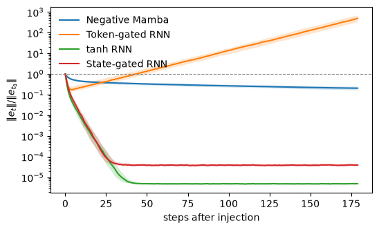
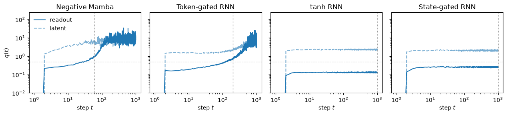
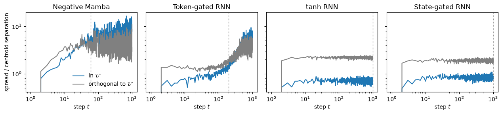

# Rethinking State Tracking in Recurrent Models Through Error Control Dynamics

Jiwan Chung, Heechan Choi, Seon Joo Kim · NeurIPS 2026

[Paper](https://arxiv.org/abs/2605.07755) · [Project page](https://jiwanchung.github.io/rethinking-state-tracking/)

Whether a recurrent model can track a symbolic state over long sequences depends not only on
which transitions it can express, but on error control: how its hidden state drifts along the
directions that distinguish symbolic states. Affine recurrent networks, which include
state-space models and linear attention, cannot correct errors along these directions once they
preserve the state representations (Theorem 1). They track only up to a finite horizon, set by
how fast that error accumulates. State-dependent recurrences can correct it.

## See it in a notebook

```bash
pip install -r requirements.txt
jupyter notebook notebooks/analysis.ipynb
```

The notebook trains four one-layer models on $S_3$ state tracking (output the running product
of a sequence of permutations of three elements): two affine models, Negative Mamba and
Token-gated RNN, and two state-dependent ones, tanh RNN and State-gated RNN. It then measures
their error control in three ways. Training the four models takes about four minutes on one GPU.
The plots below are its output.

**Perturbation recovery.** Gaussian noise is added to the hidden state at one step, and the
perturbed rollout is compared with a clean one on the same inputs. The state-dependent models
collapse the error by several orders of magnitude within tens of steps. Negative Mamba shrinks
it only through the global decay of its state, and Token-gated RNN amplifies it.



**Distinguishability ratio.** Over 200 rollouts of length 1000, $q(t)$ is the mean distance
of a state to the centroid of its symbolic state, divided by the smallest distance between two
centroids, both measured at the readout. The states remain readable while $q(t) < 1/2$.
tanh RNN and State-gated RNN stay below $1/2$ throughout; Negative Mamba and Token-gated RNN
climb past it near the length at which their accuracy fails (dotted line).



**Where the error lies.** The spread around each centroid is split into its part in the
subspace $\mathcal U$ spanned by the centroids, along which affine models cannot contract
errors, and the rest. For Negative Mamba and Token-gated RNN, most spread first lies outside
$\mathcal U$, but near each model's failure length it shifts into $\mathcal U$. The
state-dependent models keep the spread along $\mathcal U$ suppressed.



## Reproducing Table 2

Table 2 reports how far each of the nine models in the paper generalizes on $C_2$, $C_6$ and
$S_3$ with one and two layers: the longest test length, up to 1000, at which a model trained on
sequences of length at most 60 still reaches 90% accuracy, taking the best run over a grid of
state sizes, learning rates, schedulers and seeds. `scripts/main_table.py` runs that grid and
prints the table:

```bash
python scripts/main_table.py run --models tanh_rnn --tasks S3   # one model on one task
python scripts/main_table.py run                                # the whole table
python scripts/main_table.py table                              # print the table from finished runs
```

Each run is saved as a JSON file in `results/` and finished runs are skipped, so a sweep can be
stopped and resumed, or split across GPUs with `--shard i/n`. The whole table is expensive:
AUSSM and Simple AUSSM take hours per run. Mamba also needs `pip install mamba-ssm causal-conv1d`
and a CUDA GPU.

The models are `tanh_rnn` and `state_gated_rnn` (state-dependent), and `linear_rnn`,
`token_gated_rnn`, `neg_mamba`, `mamba`, `mamba3`, `aussm` and `simple_aussm` (affine). They
are defined in `state_tracking/models.py`; training and evaluation are in `state_tracking/train.py`,
and the measurements of the notebook in `state_tracking/analysis.py`.

## Citation

```bibtex
@inproceedings{chung2026rethinking,
  title={Rethinking State Tracking in Recurrent Models Through Error Control Dynamics},
  author={Chung, Jiwan and Choi, Heechan and Kim, Seon Joo},
  booktitle={Advances in Neural Information Processing Systems},
  year={2026}
}
```
